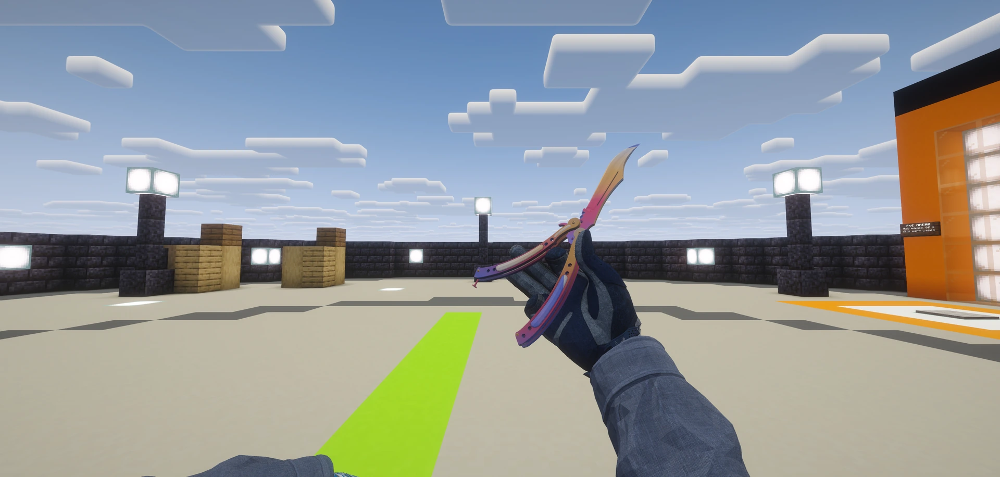
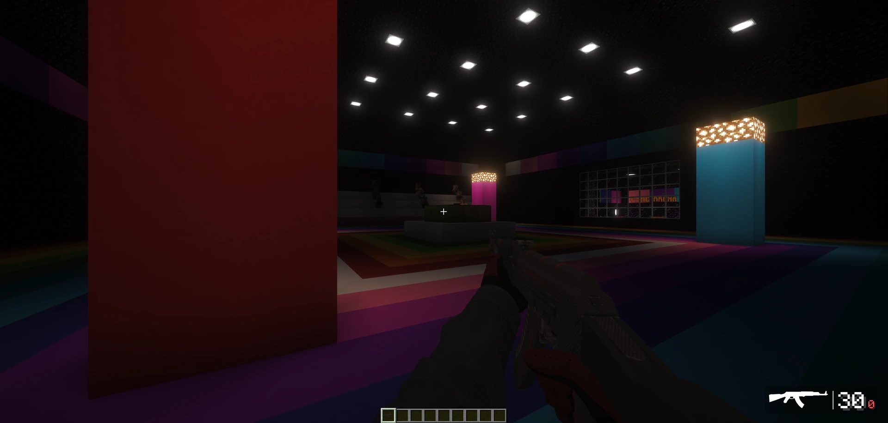
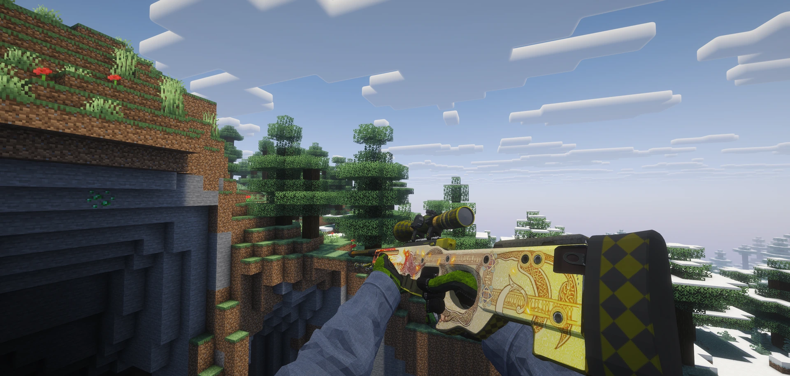

<div align="center">

# CSMC

**Counter-Strike gameplay. Minecraft worlds.**

[](#requirements)
[](#requirements)
[](#requirements)

[Install](docs/install.md) · [Gameplay](docs/gameplay.md) · [Host a server](docs/server.md) · [Documentation](#documentation)

<a href="docs/gallery.md"></a>

</div>

CSMC brings CS2 weapons, knives, grenades, equipment, skins and gloves, CS-style movement and surfing, and ready-made
arenas to Minecraft 1.21.1 (Fabric), for LAN play and dedicated servers. Gameplay is server-authoritative, and each
player supplies their own locally exported CS2 assets.

## Screenshot gallery

[In-game gallery](docs/gallery.md) · [Crafting gallery](docs/crafting-gallery.md) · [Item catalogue](docs/item-catalogue.md)

<table>
<tr>
<td><a href="docs/gallery.md"></a></td>
<td><a href="docs/gallery.md"></a></td>
</tr>
</table>

<sub>Screenshot shader credit: [Complementary Reimagined](https://www.complementary.dev/reimagined/).
Shaders are optional, client-only, and not distributed with CSMC.</sub>

## Features

- 36 firearms with CS2 ammunition types, reloads, scopes, recoil, penetration and block damage, plus kevlar armor
- 22 knives (slash, stab, backstab) and 8 gloves, worn from a dedicated glove slot
- Six grenades (HE, flashbang, smoke, molotov, incendiary, decoy) with a trajectory preview
- Equipment: healthshot, C4 with plant/defuse, and the defuse kit
- Weapon skins and gloves finishes, weapon cases and loadout cases with a CS-style reel, and an in-game skin picker
- First-person viewmodels with CS2 arms, gloves and animations, plus a weapon HUD
- CS:GO-style movement (bunny hopping, surfing) and surf ramps
- PvE, 1v1 PvP and Workshop-map arenas, plus a hub (see below)

See [docs/gameplay.md](docs/gameplay.md) for controls and details.

## Legal model

CSMC does not bundle Valve-exported models, textures or sounds. Repository screenshots depict rendered Minecraft
and Valve content. Each player exports models, textures, sounds and data from their **own** Counter-Strike 2 install
with the bundled tool (`tools/export-cs2-assets`) into `~/.csmc/cache`, for personal use only. Exported files are not
committed or distributed with CSMC. When the cache is absent, CSMC falls back to vanilla placeholder items and sounds.

The Workshop 1v1 arena's geometry is derived from the GPL-2.0 `am_grass2` map source; its license text and attribution
are in [`tools/licenses/am_grass2-GPL-2.0.txt`](tools/licenses/am_grass2-GPL-2.0.txt).

## Requirements

- Java 21
- Minecraft Java Edition 1.21.1
- Fabric Loader 0.19.5
- Fabric API 0.116.17+1.21.1
- A Counter-Strike 2 install (your own)
- Python 3 (plus NumPy and Pillow for glove and icon export)
- [Source2Viewer-CLI](https://s2v.app)

## Quick start (players)

1. Install Minecraft 1.21.1 with Fabric Loader 0.19.5, Fabric API and the CSMC JAR (a modpack or a manual install):
   [docs/install.md](docs/install.md).
2. Export your CS2 assets, for example:

   ```sh
   python3 tools/export-cs2-assets --weapons ak47,glock,awp,m4a1
   ```

   The full export sequence (knives, arms, skins, gloves, grenades, equipment, icons, case art) is in
   [docs/install.md](docs/install.md#export-your-cs2-assets).
3. Launch the game, join a world or server, and see [docs/gameplay.md](docs/gameplay.md) for controls.

## Building from source

```sh
git clone https://github.com/ian139/csmc-clean.git
cd csmc-clean/mod && ./gradlew build     # needs Java 21
```

Tests:

```sh
cd mod && ./gradlew test runGametest
python3 -m unittest discover -s tools -p 'test_*.py'
```

## Hosting a server

[docs/server.md](docs/server.md) is a runbook for a Linux dedicated server (Tailscale for private play, optional router
port forwarding). Arena generators are in [docs/arenas.md](docs/arenas.md); the hub is described in
[docs/hub.md](docs/hub.md).

## Repository layout

```
README.md
docs/            documentation (index below)
  dev/           maintainer notes: backlog, CS2 data research, exporter reference, release packaging
mod/             the Fabric mod (Java 21): src/main, src/client, src/test, src/gametest
tools/           Python tooling (flat; tools import each other by sibling name)
  export-cs2-assets, cs2_*.py   CS2 asset exporter and helpers
  csmc_*arena*.py, csmc_workshop_*.py   arena generators
  test_*.py                     unit tests
  licenses/                     third-party license texts
```

## Documentation

| Page | Contents |
|---|---|
| [docs/install.md](docs/install.md) | Player install (mod, Fabric, modpack) and CS2 asset export |
| [docs/gameplay.md](docs/gameplay.md) | Controls and features: guns, ammo, knives, grenades, equipment, armor, skins and cases, gloves, HUD |
| [docs/movement.md](docs/movement.md) | CS:GO movement (bunny hopping, surfing) |
| [docs/surf.md](docs/surf.md) | Surf ramps |
| [docs/balance.md](docs/balance.md) | Weapon damage and role balance |
| [docs/arenas.md](docs/arenas.md) | PvE, PvP and Workshop 1v1 arena generators |
| [docs/hub.md](docs/hub.md) | Hub |
| [docs/server.md](docs/server.md) | Hosting a dedicated server |
| [docs/dev/packaging.md](docs/dev/packaging.md) | Release packaging for maintainers |
| [docs/dev/asset-export.md](docs/dev/asset-export.md) | CS2 exporter reference: modes, cache layout, manifest records |
| [docs/dev/cs2-data.md](docs/dev/cs2-data.md) | CS2 data research |
| [docs/dev/movement-reference.md](docs/dev/movement-reference.md) | Movement physics and cited constants |
| [docs/dev/surf-import.md](docs/dev/surf-import.md) | Permitted surf-map imports |
| [docs/dev/tp-anim-blend.md](docs/dev/tp-anim-blend.md), [tp-anim-guns.md](docs/dev/tp-anim-guns.md), [tp-anim-melee.md](docs/dev/tp-anim-melee.md) | Third-person animation notes |
| [docs/dev/backlog.md](docs/dev/backlog.md) | Open work |

## License

Original contributions are licensed under [MIT](LICENSE), excluding third-party material described in [THIRD_PARTY_NOTICES.md](THIRD_PARTY_NOTICES.md). Valve-derived movement licensing remains unresolved; this repository is private pending review, not cleared for public redistribution.

NOT AN OFFICIAL MINECRAFT PRODUCT. NOT APPROVED BY OR ASSOCIATED WITH MOJANG OR MICROSOFT.

## Acknowledgements

Models, sounds and data are exported with [Source 2 Viewer](https://s2v.app) (Source2Viewer-CLI / ValveResourceFormat).
