# Crafting gallery

[Gallery](gallery.md) · [Crafting](crafting-gallery.md) · [Item catalogue](item-catalogue.md) · [README](../README.md)

Captured in an independent local Minecraft photo client, not on a production server. These are rendered gameplay and GUI screenshots, not exported asset icons or generated images. Screenshots depict Minecraft and Valve/Counter-Strike content.

All 84 static recipes and the dynamic `csmc:skin_crafting` recipe, with nine apply/swap/remove examples. Images preserve the actual Minecraft crafting interface ROI with 24-pixel transparent padding; ingredient summaries below are text references, not fabricated recipe images.

M14 is intentionally included with its actual in-game placeholder representation: its local model export is unavailable. No other weapon model has been substituted.

Some glove outputs render very small with the current in-game item renderer. These screenshots preserve that actual appearance without redrawing, substituting, or enlarging the glove icons; item names and registry IDs identify them.

## Firearms

### AK-47

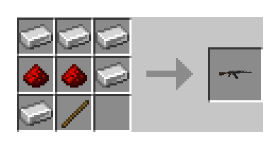

Shaped · Recipe `csmc:ak47` · Output: 1 × `csmc:ak47`.

Ingredients: 5 × `minecraft:iron_ingot`; 2 × `minecraft:redstone`; 1 × `minecraft:stick`.

### AUG

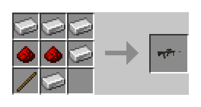

Shaped · Recipe `csmc:aug` · Output: 1 × `csmc:aug`.

Ingredients: 5 × `minecraft:iron_ingot`; 2 × `minecraft:redstone`; 1 × `minecraft:stick`.

### AWP

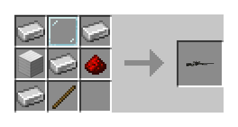

Shaped · Recipe `csmc:awp` · Output: 1 × `csmc:awp`.

Ingredients: 4 × `minecraft:iron_ingot`; 1 × `minecraft:glass_pane`; 1 × `minecraft:iron_block`; 1 × `minecraft:redstone`; 1 × `minecraft:stick`.

### PP-Bizon

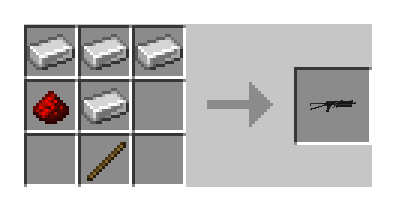

Shaped · Recipe `csmc:bizon` · Output: 1 × `csmc:bizon`.

Ingredients: 4 × `minecraft:iron_ingot`; 1 × `minecraft:redstone`; 1 × `minecraft:stick`.

### CZ75-Auto

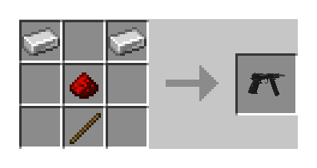

Shaped · Recipe `csmc:cz75a` · Output: 1 × `csmc:cz75a`.

Ingredients: 2 × `minecraft:iron_ingot`; 1 × `minecraft:redstone`; 1 × `minecraft:stick`.

### Desert Eagle

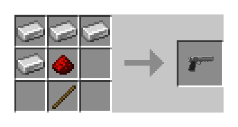

Shaped · Recipe `csmc:deagle` · Output: 1 × `csmc:deagle`.

Ingredients: 4 × `minecraft:iron_ingot`; 1 × `minecraft:redstone`; 1 × `minecraft:stick`.

### Dual Berettas

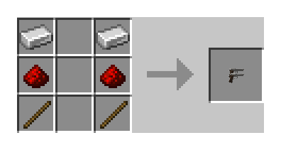

Shaped · Recipe `csmc:elite` · Output: 1 × `csmc:elite`.

Ingredients: 2 × `minecraft:iron_ingot`; 2 × `minecraft:redstone`; 2 × `minecraft:stick`.

### FAMAS

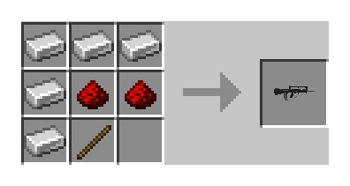

Shaped · Recipe `csmc:famas` · Output: 1 × `csmc:famas`.

Ingredients: 5 × `minecraft:iron_ingot`; 2 × `minecraft:redstone`; 1 × `minecraft:stick`.

### Five-SeveN

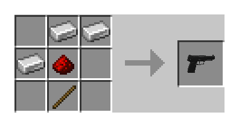

Shaped · Recipe `csmc:fiveseven` · Output: 1 × `csmc:fiveseven`.

Ingredients: 3 × `minecraft:iron_ingot`; 1 × `minecraft:redstone`; 1 × `minecraft:stick`.

### G3SG1

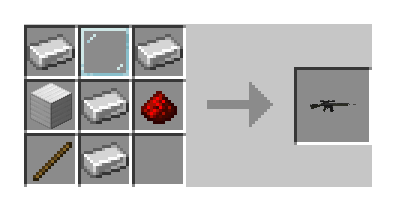

Shaped · Recipe `csmc:g3sg1` · Output: 1 × `csmc:g3sg1`.

Ingredients: 4 × `minecraft:iron_ingot`; 1 × `minecraft:glass_pane`; 1 × `minecraft:iron_block`; 1 × `minecraft:redstone`; 1 × `minecraft:stick`.

### Galil AR

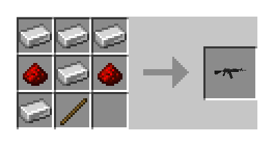

Shaped · Recipe `csmc:galilar` · Output: 1 × `csmc:galilar`.

Ingredients: 5 × `minecraft:iron_ingot`; 2 × `minecraft:redstone`; 1 × `minecraft:stick`.

### Glock-18

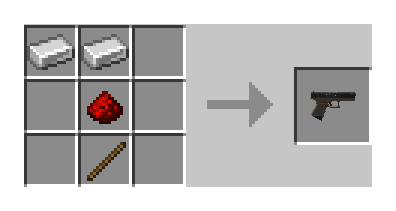

Shaped · Recipe `csmc:glock` · Output: 1 × `csmc:glock`.

Ingredients: 2 × `minecraft:iron_ingot`; 1 × `minecraft:redstone`; 1 × `minecraft:stick`.

### P2000

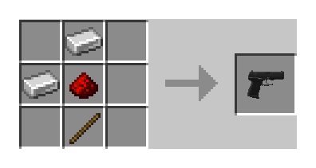

Shaped · Recipe `csmc:hkp2000` · Output: 1 × `csmc:hkp2000`.

Ingredients: 2 × `minecraft:iron_ingot`; 1 × `minecraft:redstone`; 1 × `minecraft:stick`.

### M14

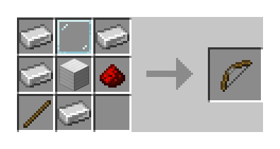

Shaped · Recipe `csmc:m14` · Output: 1 × `csmc:m14`.

Ingredients: 4 × `minecraft:iron_ingot`; 1 × `minecraft:glass_pane`; 1 × `minecraft:iron_block`; 1 × `minecraft:redstone`; 1 × `minecraft:stick`.

M14 is intentionally included with its actual in-game placeholder representation: its local model export is unavailable. No other weapon model has been substituted.

### M249

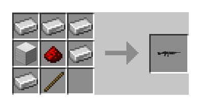

Shaped · Recipe `csmc:m249` · Output: 1 × `csmc:m249`.

Ingredients: 5 × `minecraft:iron_ingot`; 1 × `minecraft:iron_block`; 1 × `minecraft:redstone`; 1 × `minecraft:stick`.

### M4A4

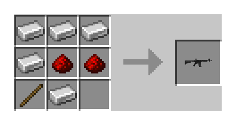

Shaped · Recipe `csmc:m4a1` · Output: 1 × `csmc:m4a1`.

Ingredients: 5 × `minecraft:iron_ingot`; 2 × `minecraft:redstone`; 1 × `minecraft:stick`.

### M4A1-S

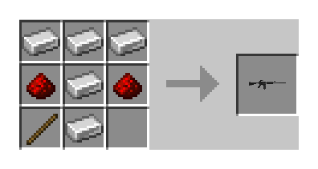

Shaped · Recipe `csmc:m4a1_silencer` · Output: 1 × `csmc:m4a1_silencer`.

Ingredients: 5 × `minecraft:iron_ingot`; 2 × `minecraft:redstone`; 1 × `minecraft:stick`.

### MAC-10

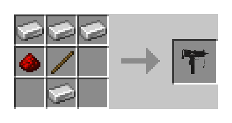

Shaped · Recipe `csmc:mac10` · Output: 1 × `csmc:mac10`.

Ingredients: 4 × `minecraft:iron_ingot`; 1 × `minecraft:redstone`; 1 × `minecraft:stick`.

### MAG-7

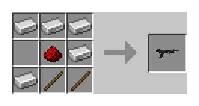

Shaped · Recipe `csmc:mag7` · Output: 1 × `csmc:mag7`.

Ingredients: 5 × `minecraft:iron_ingot`; 1 × `minecraft:redstone`; 2 × `minecraft:stick`.

### MP5-SD

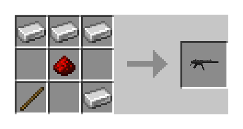

Shaped · Recipe `csmc:mp5sd` · Output: 1 × `csmc:mp5sd`.

Ingredients: 4 × `minecraft:iron_ingot`; 1 × `minecraft:redstone`; 1 × `minecraft:stick`.

### MP7

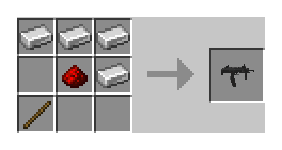

Shaped · Recipe `csmc:mp7` · Output: 1 × `csmc:mp7`.

Ingredients: 4 × `minecraft:iron_ingot`; 1 × `minecraft:redstone`; 1 × `minecraft:stick`.

### MP9

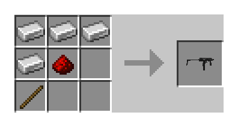

Shaped · Recipe `csmc:mp9` · Output: 1 × `csmc:mp9`.

Ingredients: 4 × `minecraft:iron_ingot`; 1 × `minecraft:redstone`; 1 × `minecraft:stick`.

### Negev

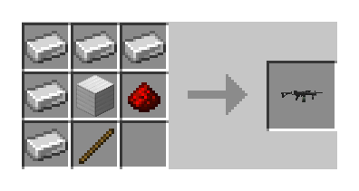

Shaped · Recipe `csmc:negev` · Output: 1 × `csmc:negev`.

Ingredients: 5 × `minecraft:iron_ingot`; 1 × `minecraft:iron_block`; 1 × `minecraft:redstone`; 1 × `minecraft:stick`.

### Nova

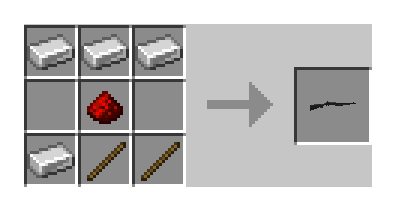

Shaped · Recipe `csmc:nova` · Output: 1 × `csmc:nova`.

Ingredients: 4 × `minecraft:iron_ingot`; 1 × `minecraft:redstone`; 2 × `minecraft:stick`.

### P250

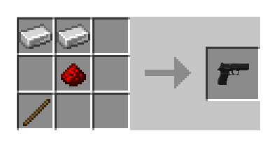

Shaped · Recipe `csmc:p250` · Output: 1 × `csmc:p250`.

Ingredients: 2 × `minecraft:iron_ingot`; 1 × `minecraft:redstone`; 1 × `minecraft:stick`.

### P90

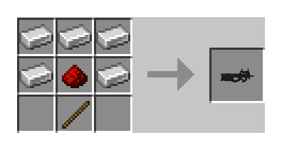

Shaped · Recipe `csmc:p90` · Output: 1 × `csmc:p90`.

Ingredients: 5 × `minecraft:iron_ingot`; 1 × `minecraft:redstone`; 1 × `minecraft:stick`.

### R8 Revolver

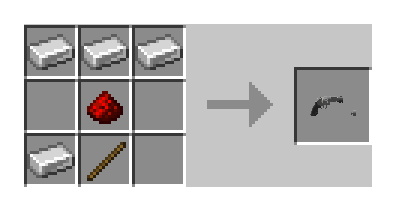

Shaped · Recipe `csmc:revolver` · Output: 1 × `csmc:revolver`.

Ingredients: 4 × `minecraft:iron_ingot`; 1 × `minecraft:redstone`; 1 × `minecraft:stick`.

### Sawed-Off

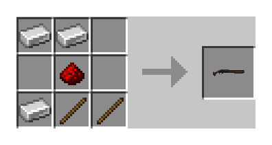

Shaped · Recipe `csmc:sawedoff` · Output: 1 × `csmc:sawedoff`.

Ingredients: 3 × `minecraft:iron_ingot`; 1 × `minecraft:redstone`; 2 × `minecraft:stick`.

### SCAR-20

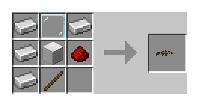

Shaped · Recipe `csmc:scar20` · Output: 1 × `csmc:scar20`.

Ingredients: 4 × `minecraft:iron_ingot`; 1 × `minecraft:glass_pane`; 1 × `minecraft:iron_block`; 1 × `minecraft:redstone`; 1 × `minecraft:stick`.

### SG 553

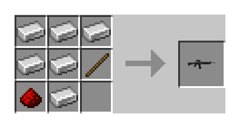

Shaped · Recipe `csmc:sg556` · Output: 1 × `csmc:sg556`.

Ingredients: 6 × `minecraft:iron_ingot`; 1 × `minecraft:stick`; 1 × `minecraft:redstone`.

### SSG 08

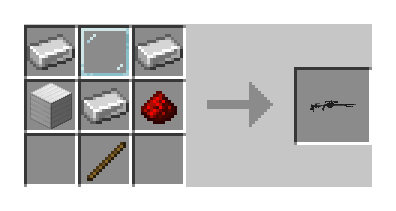

Shaped · Recipe `csmc:ssg08` · Output: 1 × `csmc:ssg08`.

Ingredients: 3 × `minecraft:iron_ingot`; 1 × `minecraft:glass_pane`; 1 × `minecraft:iron_block`; 1 × `minecraft:redstone`; 1 × `minecraft:stick`.

### Zeus x27

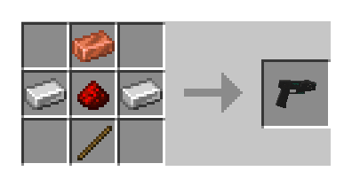

Shaped · Recipe `csmc:taser` · Output: 1 × `csmc:taser`.

Ingredients: 1 × `minecraft:copper_ingot`; 2 × `minecraft:iron_ingot`; 1 × `minecraft:redstone`; 1 × `minecraft:stick`.

### Tec-9

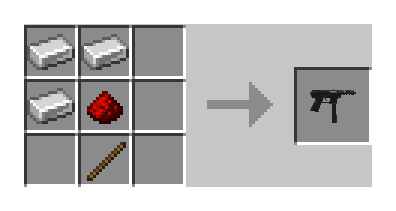

Shaped · Recipe `csmc:tec9` · Output: 1 × `csmc:tec9`.

Ingredients: 3 × `minecraft:iron_ingot`; 1 × `minecraft:redstone`; 1 × `minecraft:stick`.

### UMP-45

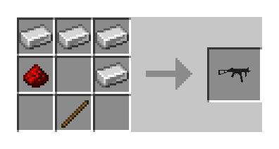

Shaped · Recipe `csmc:ump45` · Output: 1 × `csmc:ump45`.

Ingredients: 4 × `minecraft:iron_ingot`; 1 × `minecraft:redstone`; 1 × `minecraft:stick`.

### USP-S

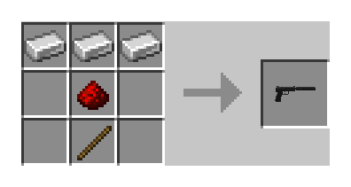

Shaped · Recipe `csmc:usp_silencer` · Output: 1 × `csmc:usp_silencer`.

Ingredients: 3 × `minecraft:iron_ingot`; 1 × `minecraft:redstone`; 1 × `minecraft:stick`.

### XM1014

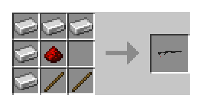

Shaped · Recipe `csmc:xm1014` · Output: 1 × `csmc:xm1014`.

Ingredients: 5 × `minecraft:iron_ingot`; 1 × `minecraft:redstone`; 2 × `minecraft:stick`.

## Knives

### Bayonet

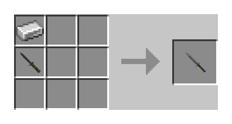

Shaped · Recipe `csmc:bayonet` · Output: 1 × `csmc:bayonet`.

Ingredients: 1 × `minecraft:iron_ingot`; 1 × `csmc:knife` or `csmc:knife_t`.

### CT Knife

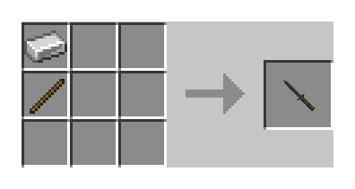

Shaped · Recipe `csmc:knife` · Output: 1 × `csmc:knife`.

Ingredients: 1 × `minecraft:iron_ingot`; 1 × `minecraft:stick`.

### Butterfly Knife

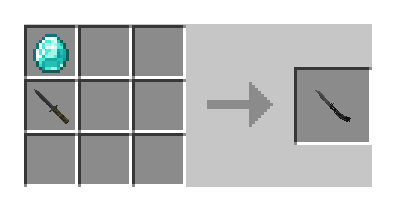

Shaped · Recipe `csmc:knife_butterfly` · Output: 1 × `csmc:knife_butterfly`.

Ingredients: 1 × `minecraft:diamond`; 1 × `csmc:knife` or `csmc:knife_t`.

### Survival Knife

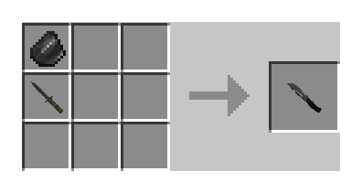

Shaped · Recipe `csmc:knife_canis` · Output: 1 × `csmc:knife_canis`.

Ingredients: 1 × `minecraft:flint`; 1 × `csmc:knife` or `csmc:knife_t`.

### Paracord Knife

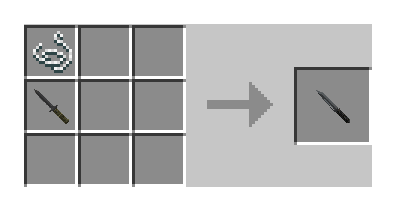

Shaped · Recipe `csmc:knife_cord` · Output: 1 × `csmc:knife_cord`.

Ingredients: 1 × `minecraft:string`; 1 × `csmc:knife` or `csmc:knife_t`.

### Classic Knife

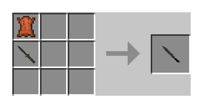

Shaped · Recipe `csmc:knife_css` · Output: 1 × `csmc:knife_css`.

Ingredients: 1 × `minecraft:leather`; 1 × `csmc:knife` or `csmc:knife_t`.

### Falchion Knife

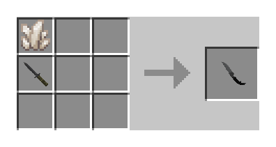

Shaped · Recipe `csmc:knife_falchion` · Output: 1 × `csmc:knife_falchion`.

Ingredients: 1 × `minecraft:quartz`; 1 × `csmc:knife` or `csmc:knife_t`.

### Flip Knife

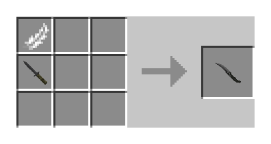

Shaped · Recipe `csmc:knife_flip` · Output: 1 × `csmc:knife_flip`.

Ingredients: 1 × `minecraft:feather`; 1 × `csmc:knife` or `csmc:knife_t`.

### Gut Knife

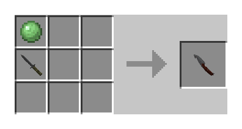

Shaped · Recipe `csmc:knife_gut` · Output: 1 × `csmc:knife_gut`.

Ingredients: 1 × `minecraft:slime_ball`; 1 × `csmc:knife` or `csmc:knife_t`.

### Navaja Knife

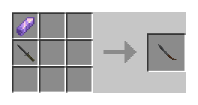

Shaped · Recipe `csmc:knife_gypsy_jackknife` · Output: 1 × `csmc:knife_gypsy_jackknife`.

Ingredients: 1 × `minecraft:amethyst_shard`; 1 × `csmc:knife` or `csmc:knife_t`.

### Karambit

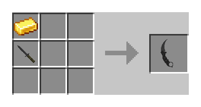

Shaped · Recipe `csmc:knife_karambit` · Output: 1 × `csmc:knife_karambit`.

Ingredients: 1 × `minecraft:gold_ingot`; 1 × `csmc:knife` or `csmc:knife_t`.

### Kukri Knife

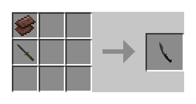

Shaped · Recipe `csmc:knife_kukri` · Output: 1 × `csmc:knife_kukri`.

Ingredients: 1 × `minecraft:netherite_scrap`; 1 × `csmc:knife` or `csmc:knife_t`.

### M9 Bayonet

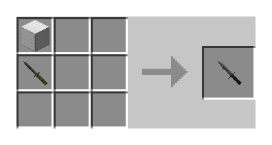

Shaped · Recipe `csmc:knife_m9_bayonet` · Output: 1 × `csmc:knife_m9_bayonet`.

Ingredients: 1 × `minecraft:iron_block`; 1 × `csmc:knife` or `csmc:knife_t`.

### Nomad Knife

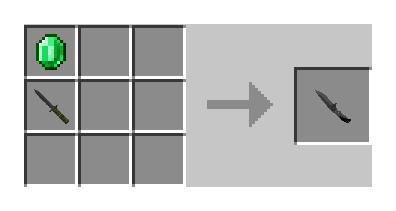

Shaped · Recipe `csmc:knife_outdoor` · Output: 1 × `csmc:knife_outdoor`.

Ingredients: 1 × `minecraft:emerald`; 1 × `csmc:knife` or `csmc:knife_t`.

### Shadow Daggers

Shaped · Recipe `csmc:knife_push` · Output: 1 × `csmc:knife_push`.

Ingredients: 1 × `minecraft:ender_pearl`; 1 × `csmc:knife` or `csmc:knife_t`.

### Skeleton Knife

Shaped · Recipe `csmc:knife_skeleton` · Output: 1 × `csmc:knife_skeleton`.

Ingredients: 1 × `minecraft:bone_block`; 1 × `csmc:knife` or `csmc:knife_t`.

### Stiletto Knife

Shaped · Recipe `csmc:knife_stiletto` · Output: 1 × `csmc:knife_stiletto`.

Ingredients: 1 × `minecraft:blaze_rod`; 1 × `csmc:knife` or `csmc:knife_t`.

### Bowie Knife

Shaped · Recipe `csmc:knife_survival_bowie` · Output: 1 × `csmc:knife_survival_bowie`.

Ingredients: 1 × `minecraft:copper_ingot`; 1 × `csmc:knife` or `csmc:knife_t`.

### T Knife

Shaped · Recipe `csmc:knife_t` · Output: 1 × `csmc:knife_t`.

Ingredients: 1 × `minecraft:iron_ingot`; 1 × `minecraft:stick`.

### Huntsman Knife

Shaped · Recipe `csmc:knife_tactical` · Output: 1 × `csmc:knife_tactical`.

Ingredients: 1 × `minecraft:bone`; 1 × `csmc:knife` or `csmc:knife_t`.

### Ursus Knife

Shaped · Recipe `csmc:knife_ursus` · Output: 1 × `csmc:knife_ursus`.

Ingredients: 1 × `minecraft:obsidian`; 1 × `csmc:knife` or `csmc:knife_t`.

### Talon Knife

Shaped · Recipe `csmc:knife_widowmaker` · Output: 1 × `csmc:knife_widowmaker`.

Ingredients: 1 × `minecraft:prismarine_shard`; 1 × `csmc:knife` or `csmc:knife_t`.

## Gloves

### Hand Wraps

Shaped · Recipe `csmc:leather_handwraps` · Output: 1 × `csmc:leather_handwraps`.

Ingredients: 4 × `minecraft:leather`; 1 × `minecraft:string`.

### Moto Gloves

Shaped · Recipe `csmc:motorcycle_gloves` · Output: 1 × `csmc:motorcycle_gloves`.

Ingredients: 4 × `minecraft:leather`; 1 × `minecraft:iron_ingot`.

### Driver Gloves

Shaped · Recipe `csmc:slick_gloves` · Output: 1 × `csmc:slick_gloves`.

Ingredients: 4 × `minecraft:leather`; 1 × `minecraft:black_dye`.

### Specialist Gloves

Shaped · Recipe `csmc:specialist_gloves` · Output: 1 × `csmc:specialist_gloves`.

Ingredients: 4 × `minecraft:leather`; 1 × `minecraft:green_dye`.

### Sport Gloves

Shaped · Recipe `csmc:sporty_gloves` · Output: 1 × `csmc:sporty_gloves`.

Ingredients: 4 × `minecraft:leather`; 1 × `minecraft:lime_wool`.

### Bloodhound Gloves

Shaped · Recipe `csmc:studded_bloodhound_gloves` · Output: 1 × `csmc:studded_bloodhound_gloves`.

Ingredients: 4 × `minecraft:leather`; 1 × `minecraft:gold_nugget`.

### Broken Fang Gloves

Shaped · Recipe `csmc:studded_brokenfang_gloves` · Output: 1 × `csmc:studded_brokenfang_gloves`.

Ingredients: 4 × `minecraft:leather`; 1 × `minecraft:bone`.

### Hydra Gloves

Shaped · Recipe `csmc:studded_hydra_gloves` · Output: 1 × `csmc:studded_hydra_gloves`.

Ingredients: 4 × `minecraft:leather`; 1 × `minecraft:prismarine_shard`.

## Ammunition

### Pistol Ammo

Shaped · Recipe `csmc:pistol_ammo` · Output: 16 × `csmc:pistol_ammo`.

Ingredients: 4 × `minecraft:iron_nugget`; 1 × `minecraft:gunpowder`.

### Rifle Ammo

Shaped · Recipe `csmc:rifle_ammo` · Output: 16 × `csmc:rifle_ammo`.

Ingredients: 4 × `minecraft:iron_nugget`; 2 × `minecraft:gunpowder`.

### Shotgun Shells

Shaped · Recipe `csmc:shotgun_shells` · Output: 8 × `csmc:shotgun_shells`.

Ingredients: 4 × `minecraft:iron_nugget`; 1 × `minecraft:paper`; 1 × `minecraft:gunpowder`.

### Sniper Ammo

Shaped · Recipe `csmc:sniper_ammo` · Output: 8 × `csmc:sniper_ammo`.

Ingredients: 4 × `minecraft:iron_ingot`; 1 × `minecraft:gunpowder`; 1 × `minecraft:iron_nugget`.

## Grenades

### Decoy Grenade

Shaped · Recipe `csmc:decoy` · Output: 1 × `csmc:decoy`.

Ingredients: 1 × `minecraft:iron_ingot`; 2 × `minecraft:gunpowder`; 1 × `minecraft:note_block`; 1 × `minecraft:redstone`.

### Flashbang

Shaped · Recipe `csmc:flashbang` · Output: 1 × `csmc:flashbang`.

Ingredients: 3 × `minecraft:iron_ingot`; 1 × `minecraft:glowstone_dust`; 1 × `minecraft:redstone`.

### HE Grenade

Shaped · Recipe `csmc:hegrenade` · Output: 1 × `csmc:hegrenade`.

Ingredients: 3 × `minecraft:iron_ingot`; 1 × `minecraft:tnt`; 1 × `minecraft:gunpowder`.

### Incendiary Grenade

Shaped · Recipe `csmc:incgrenade` · Output: 1 × `csmc:incgrenade`.

Ingredients: 1 × `minecraft:string`; 2 × `minecraft:iron_ingot`; 1 × `minecraft:fire_charge`; 1 × `minecraft:clay_ball`.

### Molotov

Shaped · Recipe `csmc:molotov` · Output: 1 × `csmc:molotov`.

Ingredients: 1 × `minecraft:string`; 1 × `minecraft:fire_charge`; 1 × `minecraft:glass_bottle`.

### Smoke Grenade

Shaped · Recipe `csmc:smokegrenade` · Output: 1 × `csmc:smokegrenade`.

Ingredients: 1 × `minecraft:string`; 2 × `minecraft:iron_ingot`; 1 × `minecraft:coal`; 1 × `minecraft:gunpowder`.

## Equipment

### C4

Shapeless · Recipe `csmc:c4` · Output: 1 × `csmc:c4`.

Ingredients: 1 × `minecraft:tnt`; 1 × `minecraft:redstone`; 1 × `minecraft:copper_ingot`; 1 × `minecraft:iron_ingot`.

### Defuse Kit

Shapeless · Recipe `csmc:defuse_kit` · Output: 1 × `csmc:defuse_kit`.

Ingredients: 1 × `minecraft:shears`; 1 × `minecraft:redstone`; 1 × `minecraft:iron_ingot`.

### Healthshot

Shapeless · Recipe `csmc:healthshot` · Output: 1 × `csmc:healthshot`.

Ingredients: 1 × `minecraft:glass_bottle`; 1 × `minecraft:iron_nugget`; 1 × `minecraft:glistering_melon_slice`.

## Armor

### Kevlar Helmet

Shaped · Recipe `csmc:kevlar_helmet` · Output: 1 × `csmc:kevlar_helmet`.

Ingredients: 3 × `minecraft:iron_ingot`; 2 × `minecraft:leather`; 1 × `minecraft:string`.

### Kevlar Vest

Shaped · Recipe `csmc:kevlar_vest` · Output: 1 × `csmc:kevlar_vest`.

Ingredients: 2 × `minecraft:string`; 4 × `minecraft:iron_ingot`; 2 × `minecraft:leather`.

## Skins and cases

### Inventory Weapon Case

Shaped · Recipe `csmc:inventory_weapon_case` · Output: 1 × `csmc:inventory_weapon_case`.

Ingredients: 1 × `minecraft:compass`; 3 × `minecraft:iron_ingot`; 1 × `csmc:weapon_case`.

### Weapon Case

Shaped · Recipe `csmc:weapon_case` · Output: 1 × `csmc:weapon_case`.

Ingredients: 8 × `minecraft:iron_ingot`; 1 × `minecraft:chest`.

## Surf

### Surf Ramp

Shaped · Recipe `csmc:surf_ramp` · Output: 6 × `csmc:surf_ramp`.

Ingredients: 3 × `minecraft:quartz`; 3 × `minecraft:smooth_stone`.

## Dynamic skin crafting

Recipe `csmc:skin_crafting` works with firearms, knives, and gloves. Use exactly one skinnable item, optionally with exactly one matching skin attachment, in a grid of at least 2 × 2. Other inputs are invalid. A lone unskinned item does not craft anything. Swapping or removing returns the previous skin as an attachment in the original item input slot.

### Firearms

#### Apply — AK-47

Example `skin-apply-firearm` · Recipe `csmc:skin_crafting`.

**Inputs:** 1 × `csmc:ak47`; 1 × `csmc:weapon_skin` (Redline; paint kit 282, seed 17, wear 0.12).

**Output:** 1 × `csmc:ak47` (Redline; paint kit 282, seed 17, wear 0.12).

**Returned skin:** none.

#### Swap — AK-47

Example `skin-swap-firearm` · Recipe `csmc:skin_crafting`.

**Inputs:** 1 × `csmc:ak47` (Redline; paint kit 282, seed 17, wear 0.12); 1 × `csmc:weapon_skin` (Asiimov; paint kit 801, seed 23, wear 0.08).

**Output:** 1 × `csmc:ak47` (Asiimov; paint kit 801, seed 23, wear 0.08).

**Returned skin:** 1 × `csmc:weapon_skin` (Redline; paint kit 282, seed 17, wear 0.12).

#### Remove — AK-47

Example `skin-remove-firearm` · Recipe `csmc:skin_crafting`.

**Inputs:** 1 × `csmc:ak47` (Redline; paint kit 282, seed 17, wear 0.12).

**Output:** 1 × `csmc:ak47`.

**Returned skin:** 1 × `csmc:weapon_skin` (Redline; paint kit 282, seed 17, wear 0.12).

### Knives

#### Apply — Butterfly Knife

Example `skin-apply-knife` · Recipe `csmc:skin_crafting`.

**Inputs:** 1 × `csmc:knife_butterfly`; 1 × `csmc:weapon_skin` (Fade; paint kit 38, seed 42, wear 0.01).

**Output:** 1 × `csmc:knife_butterfly` (Fade; paint kit 38, seed 42, wear 0.01).

**Returned skin:** none.

#### Swap — Butterfly Knife

Example `skin-swap-knife` · Recipe `csmc:skin_crafting`.

**Inputs:** 1 × `csmc:knife_butterfly` (Fade; paint kit 38, seed 42, wear 0.01); 1 × `csmc:weapon_skin` (Slaughter; paint kit 59, seed 113, wear 0.03).

**Output:** 1 × `csmc:knife_butterfly` (Slaughter; paint kit 59, seed 113, wear 0.03).

**Returned skin:** 1 × `csmc:weapon_skin` (Fade; paint kit 38, seed 42, wear 0.01).

#### Remove — Butterfly Knife

Example `skin-remove-knife` · Recipe `csmc:skin_crafting`.

**Inputs:** 1 × `csmc:knife_butterfly` (Fade; paint kit 38, seed 42, wear 0.01).

**Output:** 1 × `csmc:knife_butterfly`.

**Returned skin:** 1 × `csmc:weapon_skin` (Fade; paint kit 38, seed 42, wear 0.01).

### Gloves

#### Apply — Sport Gloves

Example `skin-apply-glove` · Recipe `csmc:skin_crafting`.

**Inputs:** 1 × `csmc:sporty_gloves`; 1 × `csmc:weapon_skin` (Amphibious; paint kit 10045, seed 42, wear 0.06).

**Output:** 1 × `csmc:sporty_gloves` (Amphibious; paint kit 10045, seed 42, wear 0.06).

**Returned skin:** none.

#### Swap — Sport Gloves

Example `skin-swap-glove` · Recipe `csmc:skin_crafting`.

**Inputs:** 1 × `csmc:sporty_gloves` (Amphibious; paint kit 10045, seed 42, wear 0.06); 1 × `csmc:weapon_skin` (Vice; paint kit 10048, seed 67, wear 0.06).

**Output:** 1 × `csmc:sporty_gloves` (Vice; paint kit 10048, seed 67, wear 0.06).

**Returned skin:** 1 × `csmc:weapon_skin` (Amphibious; paint kit 10045, seed 42, wear 0.06).

#### Remove — Sport Gloves

Example `skin-remove-glove` · Recipe `csmc:skin_crafting`.

**Inputs:** 1 × `csmc:sporty_gloves` (Amphibious; paint kit 10045, seed 42, wear 0.06).

**Output:** 1 × `csmc:sporty_gloves`.

**Returned skin:** 1 × `csmc:weapon_skin` (Amphibious; paint kit 10045, seed 42, wear 0.06).
