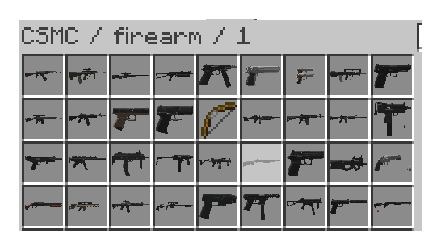
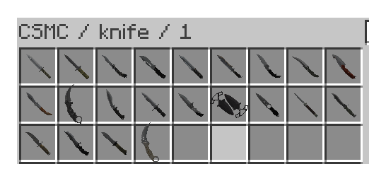
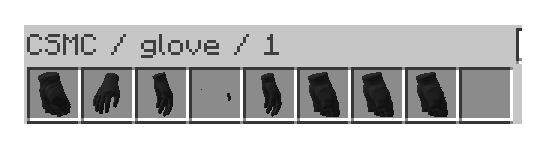
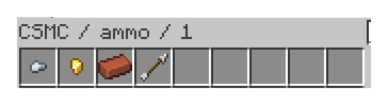
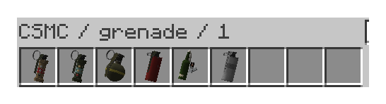
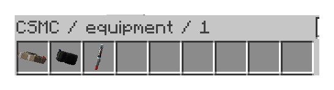
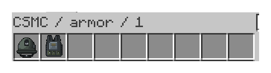
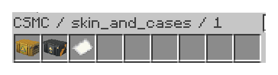
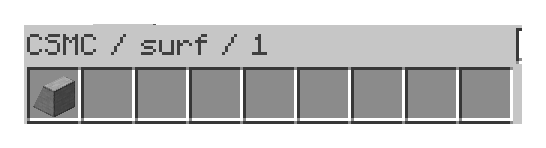

# Item catalogue

[Gallery](gallery.md) · [Crafting](crafting-gallery.md) · [Item catalogue](item-catalogue.md) · [README](../README.md)

Captured in an independent local Minecraft photo client, not on a production server. These are rendered gameplay and GUI screenshots, not exported asset icons or generated images. Screenshots depict Minecraft and Valve/Counter-Strike content.

Every registered CSMC item type: 85 items across nine categories. These are item types, not every finish variant. The tables identify every item included in each category screenshot.

Finishes are CSMC approximations, not pixel-identical Counter-Strike rendering: weapon shaders, pattern placement, seed RNG, projection, and wear are approximated; patina and Case Hardened use a tinted-pattern fallback. Gloves use baked base color; wear damage, grime, burnishing, sheen, and roughness are not reproduced by that bake. Optional shaderpacks change lighting and are not required to use CSMC.

M14 is intentionally included with its actual in-game placeholder representation: its local model export is unavailable. No other weapon model has been substituted.

## Firearms

| Item | Registry ID | Crafting |
| --- | --- | --- |
| Glock-18 | `csmc:glock` | [Recipe](crafting-gallery.md#csmc-glock) |
| P2000 | `csmc:hkp2000` | [Recipe](crafting-gallery.md#csmc-hkp2000) |
| USP-S | `csmc:usp_silencer` | [Recipe](crafting-gallery.md#csmc-usp-silencer) |
| P250 | `csmc:p250` | [Recipe](crafting-gallery.md#csmc-p250) |
| Five-SeveN | `csmc:fiveseven` | [Recipe](crafting-gallery.md#csmc-fiveseven) |
| Tec-9 | `csmc:tec9` | [Recipe](crafting-gallery.md#csmc-tec9) |
| CZ75-Auto | `csmc:cz75a` | [Recipe](crafting-gallery.md#csmc-cz75a) |
| Desert Eagle | `csmc:deagle` | [Recipe](crafting-gallery.md#csmc-deagle) |
| Dual Berettas | `csmc:elite` | [Recipe](crafting-gallery.md#csmc-elite) |
| R8 Revolver | `csmc:revolver` | [Recipe](crafting-gallery.md#csmc-revolver) |
| MAC-10 | `csmc:mac10` | [Recipe](crafting-gallery.md#csmc-mac10) |
| MP9 | `csmc:mp9` | [Recipe](crafting-gallery.md#csmc-mp9) |
| MP7 | `csmc:mp7` | [Recipe](crafting-gallery.md#csmc-mp7) |
| MP5-SD | `csmc:mp5sd` | [Recipe](crafting-gallery.md#csmc-mp5sd) |
| UMP-45 | `csmc:ump45` | [Recipe](crafting-gallery.md#csmc-ump45) |
| P90 | `csmc:p90` | [Recipe](crafting-gallery.md#csmc-p90) |
| PP-Bizon | `csmc:bizon` | [Recipe](crafting-gallery.md#csmc-bizon) |
| FAMAS | `csmc:famas` | [Recipe](crafting-gallery.md#csmc-famas) |
| Galil AR | `csmc:galilar` | [Recipe](crafting-gallery.md#csmc-galilar) |
| AK-47 | `csmc:ak47` | [Recipe](crafting-gallery.md#csmc-ak47) |
| M4A4 | `csmc:m4a1` | [Recipe](crafting-gallery.md#csmc-m4a1) |
| M4A1-S | `csmc:m4a1_silencer` | [Recipe](crafting-gallery.md#csmc-m4a1-silencer) |
| AUG | `csmc:aug` | [Recipe](crafting-gallery.md#csmc-aug) |
| SG 553 | `csmc:sg556` | [Recipe](crafting-gallery.md#csmc-sg556) |
| SSG 08 | `csmc:ssg08` | [Recipe](crafting-gallery.md#csmc-ssg08) |
| AWP | `csmc:awp` | [Recipe](crafting-gallery.md#csmc-awp) |
| SCAR-20 | `csmc:scar20` | [Recipe](crafting-gallery.md#csmc-scar20) |
| G3SG1 | `csmc:g3sg1` | [Recipe](crafting-gallery.md#csmc-g3sg1) |
| M14 | `csmc:m14` | [Recipe](crafting-gallery.md#csmc-m14) |
| Nova | `csmc:nova` | [Recipe](crafting-gallery.md#csmc-nova) |
| XM1014 | `csmc:xm1014` | [Recipe](crafting-gallery.md#csmc-xm1014) |
| MAG-7 | `csmc:mag7` | [Recipe](crafting-gallery.md#csmc-mag7) |
| Sawed-Off | `csmc:sawedoff` | [Recipe](crafting-gallery.md#csmc-sawedoff) |
| M249 | `csmc:m249` | [Recipe](crafting-gallery.md#csmc-m249) |
| Negev | `csmc:negev` | [Recipe](crafting-gallery.md#csmc-negev) |
| Zeus x27 | `csmc:taser` | [Recipe](crafting-gallery.md#csmc-taser) |

## Knives

| Item | Registry ID | Crafting |
| --- | --- | --- |
| CT Knife | `csmc:knife` | [Recipe](crafting-gallery.md#csmc-knife) |
| T Knife | `csmc:knife_t` | [Recipe](crafting-gallery.md#csmc-knife-t) |
| Bayonet | `csmc:bayonet` | [Recipe](crafting-gallery.md#csmc-bayonet) |
| Classic Knife | `csmc:knife_css` | [Recipe](crafting-gallery.md#csmc-knife-css) |
| Flip Knife | `csmc:knife_flip` | [Recipe](crafting-gallery.md#csmc-knife-flip) |
| Gut Knife | `csmc:knife_gut` | [Recipe](crafting-gallery.md#csmc-knife-gut) |
| Karambit | `csmc:knife_karambit` | [Recipe](crafting-gallery.md#csmc-knife-karambit) |
| M9 Bayonet | `csmc:knife_m9_bayonet` | [Recipe](crafting-gallery.md#csmc-knife-m9-bayonet) |
| Huntsman Knife | `csmc:knife_tactical` | [Recipe](crafting-gallery.md#csmc-knife-tactical) |
| Falchion Knife | `csmc:knife_falchion` | [Recipe](crafting-gallery.md#csmc-knife-falchion) |
| Bowie Knife | `csmc:knife_survival_bowie` | [Recipe](crafting-gallery.md#csmc-knife-survival-bowie) |
| Butterfly Knife | `csmc:knife_butterfly` | [Recipe](crafting-gallery.md#csmc-knife-butterfly) |
| Shadow Daggers | `csmc:knife_push` | [Recipe](crafting-gallery.md#csmc-knife-push) |
| Paracord Knife | `csmc:knife_cord` | [Recipe](crafting-gallery.md#csmc-knife-cord) |
| Survival Knife | `csmc:knife_canis` | [Recipe](crafting-gallery.md#csmc-knife-canis) |
| Ursus Knife | `csmc:knife_ursus` | [Recipe](crafting-gallery.md#csmc-knife-ursus) |
| Navaja Knife | `csmc:knife_gypsy_jackknife` | [Recipe](crafting-gallery.md#csmc-knife-gypsy-jackknife) |
| Nomad Knife | `csmc:knife_outdoor` | [Recipe](crafting-gallery.md#csmc-knife-outdoor) |
| Stiletto Knife | `csmc:knife_stiletto` | [Recipe](crafting-gallery.md#csmc-knife-stiletto) |
| Talon Knife | `csmc:knife_widowmaker` | [Recipe](crafting-gallery.md#csmc-knife-widowmaker) |
| Skeleton Knife | `csmc:knife_skeleton` | [Recipe](crafting-gallery.md#csmc-knife-skeleton) |
| Kukri Knife | `csmc:knife_kukri` | [Recipe](crafting-gallery.md#csmc-knife-kukri) |

## Gloves

| Item | Registry ID | Crafting |
| --- | --- | --- |
| Bloodhound Gloves | `csmc:studded_bloodhound_gloves` | [Recipe](crafting-gallery.md#csmc-studded-bloodhound-gloves) |
| Sport Gloves | `csmc:sporty_gloves` | [Recipe](crafting-gallery.md#csmc-sporty-gloves) |
| Driver Gloves | `csmc:slick_gloves` | [Recipe](crafting-gallery.md#csmc-slick-gloves) |
| Hand Wraps | `csmc:leather_handwraps` | [Recipe](crafting-gallery.md#csmc-leather-handwraps) |
| Moto Gloves | `csmc:motorcycle_gloves` | [Recipe](crafting-gallery.md#csmc-motorcycle-gloves) |
| Specialist Gloves | `csmc:specialist_gloves` | [Recipe](crafting-gallery.md#csmc-specialist-gloves) |
| Hydra Gloves | `csmc:studded_hydra_gloves` | [Recipe](crafting-gallery.md#csmc-studded-hydra-gloves) |
| Broken Fang Gloves | `csmc:studded_brokenfang_gloves` | [Recipe](crafting-gallery.md#csmc-studded-brokenfang-gloves) |

## Ammunition

| Item | Registry ID | Crafting |
| --- | --- | --- |
| Pistol Ammo | `csmc:pistol_ammo` | [Recipe](crafting-gallery.md#csmc-pistol-ammo) |
| Rifle Ammo | `csmc:rifle_ammo` | [Recipe](crafting-gallery.md#csmc-rifle-ammo) |
| Sniper Ammo | `csmc:sniper_ammo` | [Recipe](crafting-gallery.md#csmc-sniper-ammo) |
| Shotgun Shells | `csmc:shotgun_shells` | [Recipe](crafting-gallery.md#csmc-shotgun-shells) |

## Grenades

| Item | Registry ID | Crafting |
| --- | --- | --- |
| HE Grenade | `csmc:hegrenade` | [Recipe](crafting-gallery.md#csmc-hegrenade) |
| Flashbang | `csmc:flashbang` | [Recipe](crafting-gallery.md#csmc-flashbang) |
| Smoke Grenade | `csmc:smokegrenade` | [Recipe](crafting-gallery.md#csmc-smokegrenade) |
| Molotov | `csmc:molotov` | [Recipe](crafting-gallery.md#csmc-molotov) |
| Incendiary Grenade | `csmc:incgrenade` | [Recipe](crafting-gallery.md#csmc-incgrenade) |
| Decoy Grenade | `csmc:decoy` | [Recipe](crafting-gallery.md#csmc-decoy) |

## Equipment

| Item | Registry ID | Crafting |
| --- | --- | --- |
| Healthshot | `csmc:healthshot` | [Recipe](crafting-gallery.md#csmc-healthshot) |
| C4 | `csmc:c4` | [Recipe](crafting-gallery.md#csmc-c4) |
| Defuse Kit | `csmc:defuse_kit` | [Recipe](crafting-gallery.md#csmc-defuse-kit) |

## Armor

| Item | Registry ID | Crafting |
| --- | --- | --- |
| Kevlar Vest | `csmc:kevlar_vest` | [Recipe](crafting-gallery.md#csmc-kevlar-vest) |
| Kevlar Helmet | `csmc:kevlar_helmet` | [Recipe](crafting-gallery.md#csmc-kevlar-helmet) |

## Skins and cases

| Item | Registry ID | Crafting |
| --- | --- | --- |
| Skin Attachment | `csmc:weapon_skin` | [Apply, swap, remove](crafting-gallery.md#dynamic-skin-crafting) |
| Weapon Case | `csmc:weapon_case` | [Recipe](crafting-gallery.md#csmc-weapon-case) |
| Inventory Weapon Case | `csmc:inventory_weapon_case` | [Recipe](crafting-gallery.md#csmc-inventory-weapon-case) |

## Surf

| Item | Registry ID | Crafting |
| --- | --- | --- |
| Surf Ramp | `csmc:surf_ramp` | [Recipe](crafting-gallery.md#csmc-surf-ramp) |
